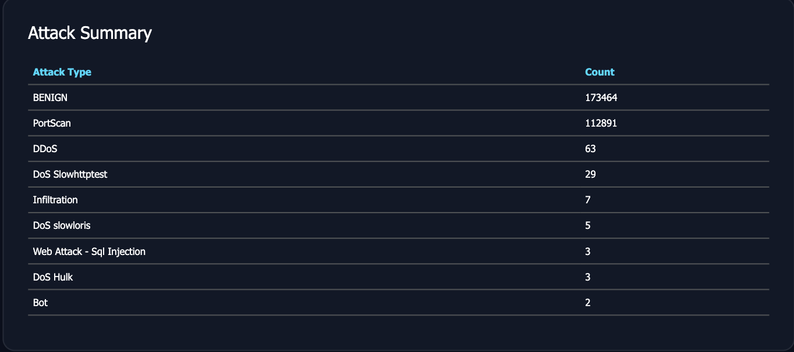

# AI-Powered Real-Time Network Intrusion Detection System (AI-RealTime-IDS)

A **hybrid AI-powered Network Intrusion Detection System (NIDS)** that performs **real-time packet capture, flow-based feature extraction, deep learning inference (CNN + BiLSTM + Attention), and live attack monitoring through a Flask dashboard**.

The project combines a **deep learning classifier** with a **behavior-based rule engine** to monitor live network traffic and detect suspicious activity — including PortScan, DDoS, Brute Force, Bot traffic, and Web Attacks — in real time.

## Features

* Real-time packet capture using **Scapy**
* Flow-based traffic analysis with correct microsecond-precision timing (matched to CICFlowMeter conventions)
* **47 network traffic features** extracted live, in the same units and order as training
* **CNN + BiLSTM + Bahdanau Attention** deep learning classifier
* **Hybrid detection engine**: ML classifier + behavior-based PortScan rule detector
* **Confidence-thresholded alerting** — low-confidence non-benign predictions are surfaced as "Uncertain" rather than false-flagged as attacks
* Cooldown-based re-alerting (repeated attacks from the same source are re-flagged after a configurable interval, without spamming)
* Live Flask dashboard with permanent session statistics, scrollable live feed, and a persistent attack history
* Modular preprocessing, training, and deployment pipeline

## Screenshots

### Real-Time Dashboard



## System Architecture

```text
Network Traffic
       |
       v
Packet Capture (Scapy)
       |
       v
Flow Manager
       |
       +----------------------+
       |                      |
       v                      v
Feature Extraction      PortScan Detector (rule-based)
       |                      |
       v                      |
CNN + BiLSTM + Attention Model |
       |                      |
       +----------+-----------+
                  |
                  v
          Flask Dashboard
                  |
                  v
   Live Feed + Attack History + Stats
```

## Project Structure

```text
AI-RealTime-IDS/
├── app.py
├── config.py
├── dashboard/
├── packet_capture/
├── preprocessing/
├── realtime/
├── training/
├── static/
├── templates/
├── utils/
├── dataset/
│   └── metadata/
├── screenshots/
├── requirements.txt
└── README.md
```

## Technologies Used

* Python 3.11
* Flask
* Scapy
* TensorFlow / Keras
* NumPy
* Pandas
* scikit-learn
* Joblib
* HTML, CSS, JavaScript

## Deep Learning Model

The detection engine uses a hybrid architecture:

* **CNN** for local packet-pattern extraction
* **BiLSTM** for temporal sequence learning
* **Bahdanau Attention** for adaptive feature weighting

This architecture is designed to capture both **spatial** and **temporal characteristics** of network traffic flows.

## Dataset

The model was trained using traffic derived from the **CICIDS2017** dataset.

Supported attack categories include:

* BENIGN
* Bot
* DDoS
* DoS GoldenEye
* DoS Hulk
* DoS Slowhttptest
* DoS Slowloris
* FTP-Patator
* Heartbleed
* Infiltration
* PortScan
* SSH-Patator
* Web Attack - Brute Force
* Web Attack - SQL Injection
* Web Attack - XSS

## Installation

### Clone the repository

```bash
git clone https://github.com/theanirudh18/AI-Powered-Real-Time-Network-IntrusionDetection.git
cd AI-Powered-Real-Time-Network-IntrusionDetection
```

### Create a virtual environment

```bash
python3 -m venv venv
source venv/bin/activate
```

### Install dependencies

```bash
pip install -r requirements.txt
```

## Running the Project

Start the IDS:

```bash
sudo venv/bin/python app.py
```

The dashboard will be available at:

```text
http://127.0.0.1:8000/realtime
```

## Real-Time PortScan Test

From the same machine or another device on the network, scan a **different, responsive host** on your LAN (do not scan the machine running the IDS itself — loopback traffic never reaches the capture interface):

```bash
sudo nmap -sS -Pn <target-ip>
```

The system performs, end to end:

* Real-time packet capture
* Flow construction (correct microsecond-precision duration/IAT features)
* Feature extraction (47 features, matched to training-time units and ordering)
* AI inference (CNN + BiLSTM + Attention)
* Behavior-based PortScan detection (20+ distinct destination ports from one source within a 5-second window)
* Live dashboard update — stat cards, live feed, and persistent attack history

## Current Status

### Implemented

* Real-time packet capture
* Flow management with accurate timing (fixed a seconds-vs-microseconds unit mismatch between live capture and CICFlowMeter-derived training data)
* Feature extraction (47 features)
* CNN + BiLSTM + Attention inference
* Behavior-based PortScan detection, wired into the live alert pipeline
* Cooldown-based re-alerting per source IP
* Confidence-thresholded classification (separates genuine attacks from low-confidence "Uncertain" predictions)
* Live Flask dashboard: permanent session stats, scrollable live feed, persistent attack history table with accurate timestamps

### Known Limitations

* The ML classifier's PortScan detection is most reliable for probe flows that receive a response (RST/SYN-ACK); scans against hosts that silently drop filtered ports are underrepresented in the CICIDS2017 training distribution for this class. The rule-based detector exists specifically to cover this gap.
* Session statistics reset on application restart (in-memory only, no persistent database).
* Tested primarily against PortScan on a local network; other attack categories (DDoS, Brute Force, Web Attacks) rely on the trained classifier without a dedicated rule-based backstop.

## Future Improvements

* Persistent storage (SQLite) so statistics and history survive restarts
* Attention-weight visualization in the dashboard for per-prediction explainability
* Live testing and validation against additional attack categories (DoS, Brute Force)
* Automated response (temporary IP blocking) on high-confidence detections
* Email/SMS alert notifications
* REST API support
* Docker deployment
* Multi-interface monitoring

## Disclaimer

This project is intended for **educational, research, and authorized cybersecurity testing purposes only**. Use only on networks and systems for which you have explicit permission.

## Author

**Anirudh Singh**

GitHub: https://github.com/theanirudh18

---

If you find this project useful, consider giving it a star.
